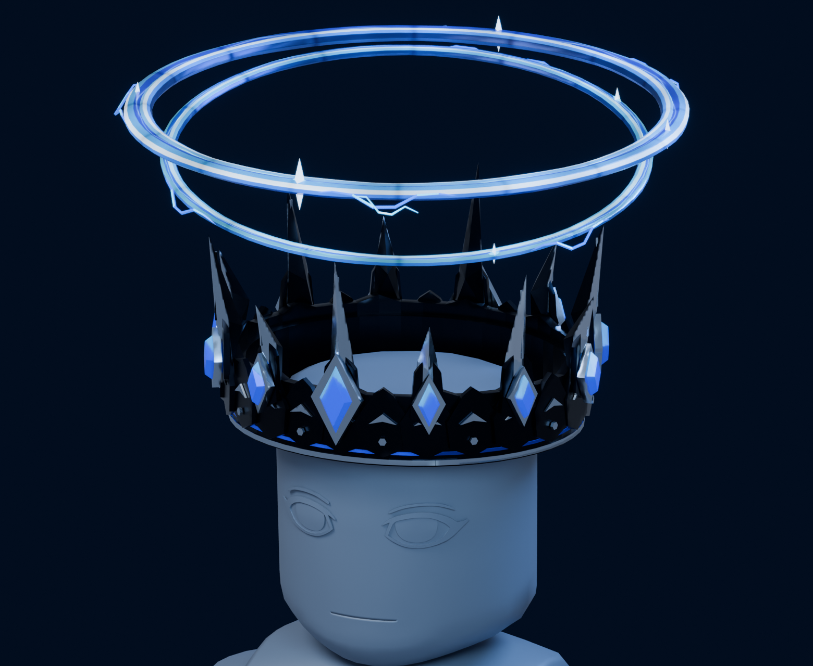

# 02 · ZAREK Eternal Halo

Eternal Halo combina un aro horizontal grueso con otro más fino inclinado 9°. Cada aro tiene un perfil de varias caras con canales de cobalto, cian y perfiles blancos. Los destellos de cuatro puntas y las bifurcaciones eléctricas tienen volumen. Las vetas y el desgaste fino se integran en el atlas PBR.

| Versión | Editable | Uso |
| --- | --- | --- |
| MASTER | [Blend](blender/EternalHalo_MASTER.blend) | 79 piezas editables y 17.672 triángulos. Filamentos, prismas y aros independientes. |
| UGC | [Blend](blender/EternalHalo_UGC.blend) · [FBX](exportaciones/EternalHalo_UGC.fbx) · [GLB](exportaciones/EternalHalo_UGC.glb) | Una malla rígida de 3.628 triángulos, un material y un UV. Hat Classic con importación y ajuste manual AFT confirmados por el equipo. |
| GOD MODE | [Blend](blender/EternalHalo_GOD_MODE.blend) · [FBX](exportaciones/EternalHalo_GOD_MODE.fbx) · [GLB](exportaciones/EternalHalo_GOD_MODE.glb) | Dos grupos con pivotes y ocho puntos FX. El .blend incluye un giro de demostración de 240 fotogramas. Los dos MeshPart se pueden preparar en Studio a partir de la exportación en reposo. |

El [escenario combinado](blender/EternalHalo_R15_DivineCrown.blend) contiene el maniquí oficial Classic R15, la corona UGC del PR #1 y el halo UGC. Se usó el ajuste de referencia de Blender de la corona. El RBXL del PR #1 documenta la prueba manual separada de Divine Crown.

- [Vistas del conjunto](renders/lamina_conjunto.jpg) y [R15 de cuerpo completo](renders/conjunto_R15_completo.png).
- [Vistas del halo](renders/lamina_halo.jpg) y [comparación con el concepto original](renders/comparacion_referencia.jpg).
- [Informe y mediciones](validacion/INFORME.md). [Pasos de Studio e integración](roblox/LEEME.md).

## Prueba manual en Studio

El equipo del usuario confirmó la importación de Eternal Halo y el ajuste visual conjunto con Divine Crown mediante AFT en Roblox Studio. Aprobó provisionalmente la apariencia del conjunto. [Escena de prueba](roblox/EternalHalo_Test.rbxl).

## Reproducir

Ejecutar scripts/run.ps1 desde PowerShell con Blender 5.2.2 y un dispositivo OptiX disponible. Se puede pasar la ruta a Blender con -Blender. Para regenerar las láminas, ejecutar scripts/layout_review.py con Python y Pillow. Los modelos tienen sus imágenes PBR empaquetadas. El escenario combinado usa la escena original del PR #1 como fuente de Blender.

## Dependencia en GitHub

La rama accessory/02-eternal-halo nace del commit de Divine Crown que incorpora la validación manual y el archivo RBXL. Su PR usa accessory/01-divine-crown como base para revisar solo el halo. Cuando se autorice integrar la corona, la base del segundo PR deberá actualizarse a main y el diff deberá revisarse si la corona se integra con squash.

La comparación utiliza el arte original del avatar ZAREK. La geometría y las texturas del halo se generaron para este proyecto. El maniquí se usa como referencia de ajuste conforme a la [documentación de Roblox](https://create.roblox.com/docs/avatar/resources).
