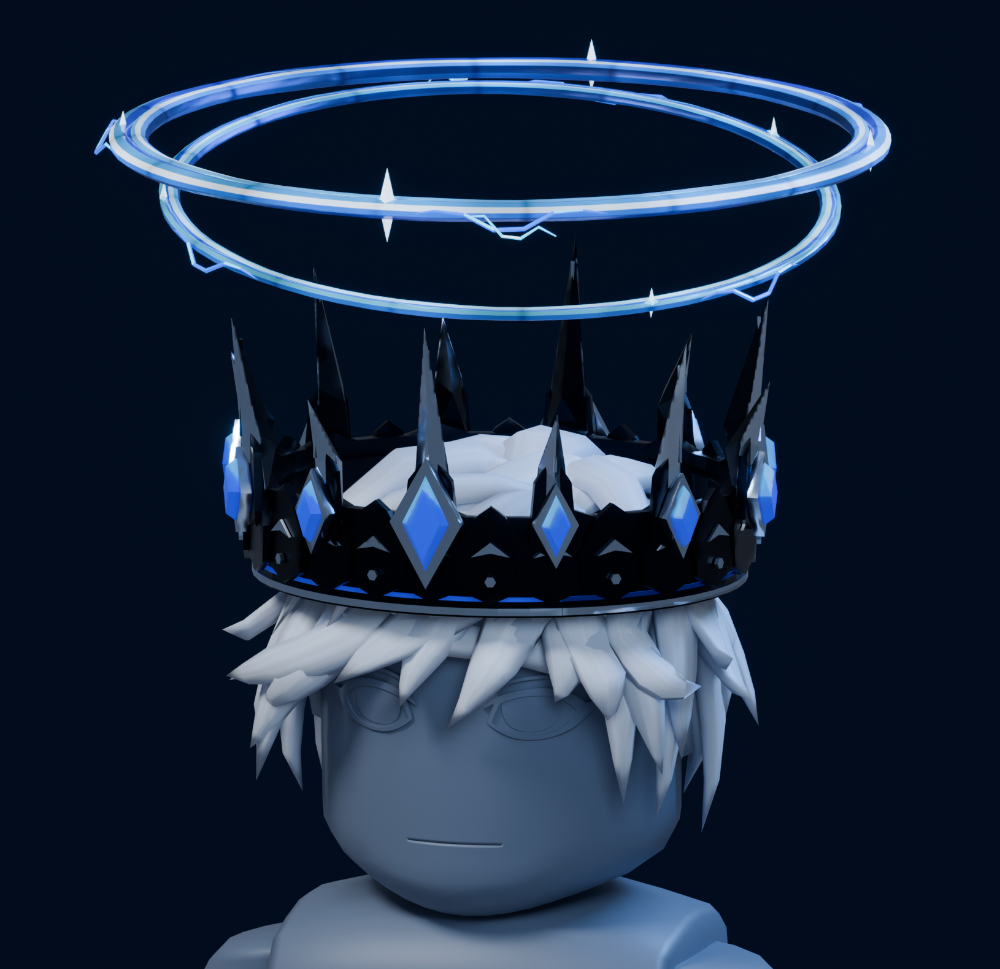

# 03 · ZAREK Celestial Hair

Cabello corto de silueta anime con un flequillo asimétrico, capas laterales curvadas y volumen en la nuca. Los 51 mechones se modelaron como volúmenes con centro Bézier, perfil de anchura variable y giro. El atlas combina blancos celestiales y sombras azuladas. El brillo plateado viene del color y de la rugosidad de la fibra.

| Entrega | Archivos |
| --- | --- |
| MASTER | [Blend](blender/CelestialHair_MASTER.blend) de 55.536 triángulos con 51 mechones y una base editables por separado. |
| UGC | [Blend](blender/CelestialHair_UGC.blend), [FBX](exportaciones/CelestialHair_UGC.fbx) y [GLB](exportaciones/CelestialHair_UGC.glb) de 3.976 triángulos, una malla, un material y un UV. |
| Escena de ajuste | [Blend del conjunto R15](blender/CelestialHair_R15_Conjunto.blend). Usa las mallas UGC existentes de Divine Crown y Eternal Halo y el maniquí Classic oficial. |
| Texturas | [Base Color](texturas/CelestialHair_BaseColor.png), [Normal OpenGL](texturas/CelestialHair_Normal.png) y [Roughness](texturas/CelestialHair_Roughness.png). Metalness constante en 0. |
| Revisión visual | [Mechones](renders/lamina_mechones.jpg), [Conjunto](renders/lamina_conjunto.jpg), [Comparación](renders/comparacion_referencia.jpg) e [Iteración del flequillo](validacion/iteracion_flequillo.jpg). |

La máxima fidelidad se buscó en el barrido del flequillo, las puntas laterales y las capas de la nuca, a partir de la vista frontal y trasera de la referencia definitiva. El ajuste usa la forma del maniquí oficial y conserva los tamaños ya aprobados de la corona y el halo. Las luces, el rostro y las demás piezas dibujadas en el concepto afectan la percepción de las proporciones.

La escena R15 verifica el ajuste estático en Blender. La importación y ajuste de Celestial Hair en Studio quedan pendientes. [Informe](validacion/INFORME.md) · [Guía de Studio](roblox/LEEME.md).

## Reproducir

Ejecutar scripts/run.ps1 con Blender 5.2.2 y una GPU compatible con OptiX. Los renders y las láminas se generan desde las mallas locales. Para generar también las láminas, pasar un ejecutable de Python con Pillow mediante -ReviewPython. Los tres modelos guardan las texturas dentro del archivo Blender. La escena R15 combinada requiere el .blend de Eternal Halo de la rama anterior como referencia de construcción.

Los puntos de control, perfiles y torsiones están en scripts/build_hair.py. Los objetos MASTER, agrupados en colecciones, se pueden editar en Blender; sus propiedades conservan las coordenadas de origen para reproducir las variaciones por script.
