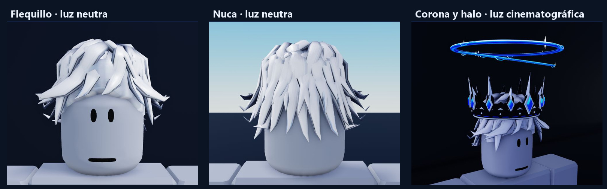

# Celestial Hair V5

Revisión artística de la propuesta C y del ajuste V4. Conserva la silueta asimétrica y los ojos despejados. La nuca es ligeramente más corta y llena, y el atlas hace visibles los filos oscuros, las sombras azul noche y los reflejos de plata en Roblox Studio.



| Entrega | Archivos |
| --- | --- |
| Diseño y comparación | [Concepto, V3 C, V4 y V5](renders/Comparacion_Concepto_C_V4_V5.jpg) · [MASTER en Cycles](renders/V5_MASTER.png) |
| Blender editable | [MASTER](blender/CelestialHair_V5_MASTER.blend) · [UGC](blender/CelestialHair_V5_UGC.blend) |
| Exportaciones UGC | [GLB con atlas PBR](exportaciones/CelestialHair_V5_UGC.glb) · [FBX](exportaciones/CelestialHair_V5_UGC.fbx) |
| Mapas | [Base Color](texturas/CelestialHair_V5_Color.png) · [Normal tangente](texturas/CelestialHair_V5_Normal.png) · [Rugosidad](texturas/CelestialHair_V5_Rugosidad.png) · [Altura de fibras del MASTER](texturas/CelestialHair_V5_Altura_MASTER.png) |
| Renders del UGC | [Frente](renders/V5_frente.png) · [Nuca](renders/V5_espalda.png) · [Perfil derecho](renders/V5_perfil.png) · [Perfil izquierdo](renders/V5_perfil_izquierdo.png) · [Tres cuartos](renders/V5_perspectiva.png) |
| Renders equipados | [Luz neutra](renders/V5_conjunto_neutro.png) · [Luz cinematográfica](renders/V5_conjunto_cine.png) |
| Roblox Studio | [Escenario V5](roblox/CelestialHair_V5_Test.rbxl) · [Tres R15](validacion/studio/reapertura.jpg) · [Corona y halo en luz neutra](validacion/studio/conjunto_frente_neutra.jpg) · [Corona y halo en luz cinematográfica](validacion/studio/conjunto_trescuartos_cine.jpg) |
| Verificación | [Informe](validacion/INFORME.md) · [Ajuste en Blender](validacion/ajuste.json) · [Reimportaciones y atlas](validacion/archivos.json) · [Registro de Studio](validacion/Studio_resultados.txt) |

## Revisión local en Studio

Abre **CelestialHair_V5_Test.rbxl** y pulsa **F5**. Si el foco quedó en el Explorador, haz clic dentro del visor.

- **0** vista general. **1** cabello. **2** cabello y Divine Crown. **3** cabello, corona y Eternal Halo.
- **V** recorre frente, tres cuartos, lateral derecho, nuca y lateral izquierdo de la configuración seleccionada.
- **L** alterna iluminación neutra y cinematográfica.
- **7**, **8** y **9** reproducen caminar, correr y saltar en los tres maniquíes.

La escena volvió a abrir con sus referencias locales en el equipo de trabajo. Si otro equipo requiere repetir la importación, usa el GLB con **Cargar a Roblox** desactivado y AFT en **Pelo · Bloque clásico**. El [script de montaje](scripts/studio_actualizar_escena.luau) parte de una copia local del escenario V4. Después del montaje, coloca el [controlador](scripts/studio_presentacion.luau) como único LocalScript de presentación bajo `StarterPlayerScripts`.

## Reproducir los modelos y las láminas

Desde `03-celestial-hair`, usa Blender 5.2 con OptiX y Python con Pillow. Descarga los modelos del repositorio con Git LFS antes de ejecutar. `$BlenderExe` apunta al ejecutable de Blender.

```powershell
& $BlenderExe --factory-startup -b -t 8 --python v5/scripts/build_v5.py -- final
& $BlenderExe --factory-startup -b --python v5/scripts/verificar_v5.py
python v5/scripts/comparar_v5.py
```

Los modos `measure` y `preview` del mismo script permiten comprobar el ajuste y el aspecto antes de generar todos los entregables. Las vistas de Studio se conservan en `validacion/studio`.
